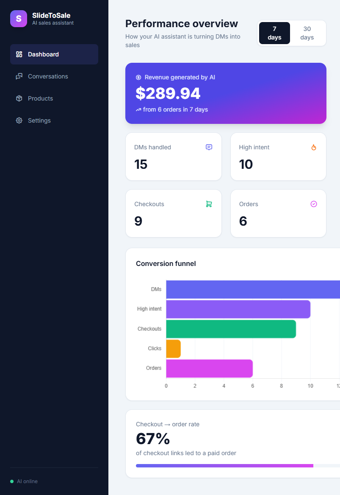

# SlideToSale

**An AI sales assistant that turns Instagram DMs into Shopify checkouts — automatically.**

When a customer messages a store asking *"do you have the black hoodie in medium?"*, SlideToSale reads the message, checks **live Shopify inventory**, replies in a natural on-brand voice, detects how ready-to-buy the customer is, and — at the right moment — drops a **one-tap checkout link** straight into the conversation. Every step is logged, so the merchant sees exactly how many DMs turned into revenue on a live dashboard.

Built end-to-end as a portfolio project using **entirely free tools** — no paid services required to run it.

---

## Table of contents

- [Demo](#demo)
- [What it does](#what-it-does)
- [Architecture](#architecture)
- [Tech stack](#tech-stack)
- [How it works (the pipeline)](#how-it-works-the-pipeline)
- [Engineering decisions](#engineering-decisions)
- [Project structure](#project-structure)
- [Database schema](#database-schema)
- [API reference](#api-reference)
- [Running locally](#running-locally)
- [Testing](#testing)
- [Notes on scope](#notes-on-scope)
- [License](#license)

---

## Demo

> **Merchant dashboard** — revenue, KPIs, and a live conversion funnel, all from real data.



> **The conversation** — a messy real message in, an accurate reply and checkout link out.

```
Customer:  I'll take the hoodie in medium!
Assistant: Great choice — the Classic Hoodie in Medium is $49.99 and in stock.
           Here is your checkout link: http://.../click/5
           → redirects to a real Shopify checkout for that exact variant
```

---

## What it does

- **Understands messy, real messages.** *"do u have the hoody in medium?"* → the assistant knows they mean the Classic Hoodie in size **M** and answers from live inventory. No exact spelling required.
- **Grounded in real data.** Every reply is built from real Shopify products, prices, and **per-variant stock**. The AI is explicitly prevented from inventing products, prices, or availability.
- **Detects buying intent.** Each message is classified as **high / medium / low**, so the system knows when to send a checkout link, when to keep nurturing, and when someone is just browsing.
- **Asks before it guesses.** If a customer says *"I want the hoodie"* without a size, the assistant asks *"which size — S, M, or L?"* (and only offers sizes that are actually in stock) rather than sending the wrong link.
- **Generates one-tap checkout links.** On high intent with a specific variant, it creates a real Shopify **Draft Order** checkout link for that exact item — a permanent, shareable URL.
- **Tracks the full funnel.** `dm_received → intent_detected → checkout_generated → checkout_clicked → purchase`, with revenue attributed back to conversations.
- **Merchant dashboard.** A polished, responsive dashboard showing revenue, funnel KPIs, and conversion rate from live analytics — with 7-day / 30-day views.
- **Hardened against abuse.** Resists prompt-injection ("ignore your instructions…"), stays strictly on-topic, and handles empty/gibberish/off-topic messages gracefully — all verified with an adversarial test suite.

---

## Architecture

A single customer message travels through five stages:

```
  ┌─────────────────────────────┐
  │  Customer sends a DM         │   Instagram → webhook
  └──────────────┬──────────────┘
                 ▼
  ┌─────────────────────────────┐
  │  Store message, load history │   FastAPI + PostgreSQL
  └──────────────┬──────────────┘
                 ▼
  ┌─────────────────────────────┐
  │  AI writes reply, scores     │   Groq (Llama 3.3 70B),
  │  intent, checks live stock   │   grounded in synced products
  └──────────────┬──────────────┘
                 ▼
  ┌─────────────────────────────┐
  │  Checkout link created       │   Shopify Draft Order
  │  (on high intent)            │   for the exact variant
  └──────────────┬──────────────┘
                 ▼
  ┌─────────────────────────────┐
  │  Reply sent, everything      │   click-tracked redirect,
  │  logged → dashboard          │   funnel events, revenue
  └─────────────────────────────┘
```

> A polished version of this diagram can be exported to `docs/architecture.png` and embedded here.

---

## Tech stack

| Layer | Technology | Why |
|---|---|---|
| **Backend** | Python 3.12, FastAPI, Uvicorn | Fast, modern, auto-generated interactive API docs |
| **Database** | PostgreSQL 16 (via Docker) | Production-grade; runs identically on every machine |
| **ORM** | SQLAlchemy + psycopg2 | Tables defined as Python classes, tracked in version control |
| **AI** | Groq — Llama 3.3 70B (`llama-3.3-70b-versatile`) | Fast enough for sub-3-second replies; generous free tier; no training on prompts |
| **Commerce** | Shopify Admin API (2025-01) + Draft Orders | Real inventory and **permanent** checkout links |
| **Scheduling** | APScheduler | Auto-syncs products every 30 minutes |
| **Config** | python-dotenv | Secrets loaded from a git-ignored `.env` |
| **Dashboard** | Tailwind CSS + Chart.js (CDN) | Clean, responsive, animated — zero build step |
| **Security** | HMAC-SHA256 | Signed webhook verification, timing-safe comparison |

**100% free-tier:** Shopify Partner development store, Groq free API, self-hosted Postgres in Docker.

---

## How it works (the pipeline)

The core is an **orchestrator** that turns one message into a full response:

1. **AI call** (`ai.py`) — one structured-output request to Groq returns a JSON object with `reply`, `intent`, `product`, and `variant`. A tight, hardened system prompt keeps it on-brand and grounded in the live product list.
2. **Decision** (`orchestrator.py`) — if `intent == "high"` **and** a specific variant was named, look that variant up in the database (`search.py`) and confirm it's in stock.
3. **Action** (`checkout.py`) — create a Shopify Draft Order for that exact variant and get its permanent `invoice_url`.
4. **Track** (`events.py`) — the raw Shopify link is stored on a `checkout_generated` event, and the customer is handed a `/click/{id}` tracking link that logs the click before redirecting to Shopify.
5. **Measure** (`analytics.py`) — every stage is a row in the `events` table, rolled up into dashboard KPIs.

Product data is kept fresh by a sync job (`sync.py`) that runs on startup and every 30 minutes, using an **upsert** so it's safe to run repeatedly.

---

## Engineering decisions

Choices that reflect deliberate judgment rather than tutorial defaults:

- **AI for judgment, code for actions.** A single structured-output AI call handles the reply *and* intent classification; deterministic code handles checkout creation. For this latency-sensitive task that's faster, cheaper, and more reliable than chaining multiple AI agents.
- **Prompt-injection hardening.** The system prompt explicitly refuses "ignore your instructions", roleplay, and off-topic requests — no exceptions — and this is verified with an adversarial test suite (`tests/ai_robustness_test.py`) covering greetings, gibberish, empty input, off-topic questions, injection attempts, and requests for products the store doesn't carry.
- **Least-privilege API scopes.** The Shopify custom app was granted only what it needs (`read_products`, `read_inventory`, `write_draft_orders`), added **incrementally** as features required them.
- **Signed webhooks.** Order webhooks are verified with HMAC-SHA256 and a timing-safe comparison before any data is trusted — fake orders are rejected with `401`.
- **Secrets never committed.** All credentials live in a git-ignored `.env`; a committed `.env.example` documents exactly what's required. This was verified (`git check-ignore`) so the token never enters version control.
- **Reproducible environment.** Pinned `requirements.txt`, PostgreSQL in Docker, and a one-command table setup mean the project rebuilds identically anywhere.
- **Structured LLM output.** Groq's JSON mode (`response_format={"type": "json_object"}`) guarantees machine-readable responses, so reply and intent are parsed reliably instead of scraped from free text.
- **Clean, incremental git history.** ~25 small, well-labelled commits read like a build log.

---

## Project structure

```
slidetosale/
├── docker-compose.yml          # PostgreSQL 16 container
├── .gitignore                  # ignores .venv, __pycache__, .env
├── README.md
└── backend/
    ├── main.py                 # FastAPI app + all routes
    ├── database.py             # engine, session, Base, get_db
    ├── models.py               # the 7-table schema (SQLAlchemy)
    ├── create_tables.py        # creates tables from the models
    ├── sync.py                 # Shopify product sync (upsert)
    ├── search.py               # product + per-variant search
    ├── ai.py                   # Groq: reply + intent + variant (hardened prompt)
    ├── orchestrator.py         # ties AI + search + checkout together
    ├── checkout.py             # Shopify Draft Order checkout links
    ├── events.py               # funnel event logging helper
    ├── analytics.py            # KPI / funnel / revenue queries
    ├── conversations.py        # find-or-create conversation by customer
    ├── requirements.txt        # pinned dependencies
    ├── .env.example            # documents required secrets (no real values)
    ├── static/
    │   └── dashboard.html      # Tailwind + Chart.js dashboard
    └── tests/                  # standalone verification scripts
        ├── shopify_test.py         # Shopify API connection
        ├── groq_test.py            # Groq API connection
        ├── ai_test.py              # grounded replies
        ├── ai_intent_test.py       # intent classification
        ├── ai_variant_test.py      # variant identification / ask-for-size
        ├── ai_robustness_test.py   # prompt-injection + edge cases
        ├── search_test.py          # product search
        ├── checkout_test.py        # draft-order link generation
        ├── pipeline_test.py        # full DM → checkout flow
        ├── webhook_test.py         # signed order webhook
        └── analytics_test.py       # KPI computation
```

---

## Database schema

Seven tables with proper foreign keys, so revenue can be attributed all the way back to a single conversation.

| Table | Key columns | Purpose |
|---|---|---|
| `merchants` | `id`, `ig_account`, `shop_domain`, `ai_enabled` | The store using the assistant |
| `conversations` | `id`, `merchant_id` → merchants, `customer_id` | One customer's ongoing chat |
| `messages` | `id`, `conversation_id` → conversations, `sender`, `text`, `intent` | Each DM and each AI reply |
| `products` | `id`, `merchant_id` → merchants, `shopify_id`, `title`, `price` | Synced Shopify products |
| `product_variants` | `id`, `product_id` → products, `shopify_variant_id`, `title`, `stock` | Per-size / per-colour stock |
| `product_mentions` | `id`, `message_id`, `product_id` | Links a message to products discussed |
| `events` | `id`, `conversation_id`, `event_type`, `order_value`, `checkout_url` | The funnel: dm_received → purchase |

**Relationships:** a merchant has many conversations and products; a conversation has many messages and events; a product has many variants.

---

## API reference

Interactive docs are auto-generated at `/docs` when the server runs.

| Method | Endpoint | Description |
|---|---|---|
| `GET` | `/` | Health check |
| `POST` | `/simulate-dm` | Send a DM `{ "customer_id": "...", "text": "..." }`; returns reply, intent, and (if applicable) a checkout link. Auto-creates a merchant-linked conversation. |
| `GET` | `/click/{event_id}` | Logs a `checkout_clicked` event, then redirects to the real Shopify checkout |
| `POST` | `/webhooks/order` | Shopify order webhook — **HMAC-verified**; logs a `purchase` event with the order value |
| `GET` | `/analytics?days=30` | Funnel KPIs and revenue for the given window (7 or 30 days) |
| `POST` | `/sync-products` | Manually trigger a Shopify product sync |
| `GET` | `/search?keyword=&variant=` | Search products / variants with live stock |
| `GET` | `/dashboard` | The merchant dashboard (served static HTML) |

Product sync also runs **automatically** on startup and every 30 minutes.

---

## Running locally

**Requirements:** Docker, Python 3.12, and free accounts for [Shopify Partners](https://partners.shopify.com) and [Groq](https://console.groq.com).

```bash
# 1. Start the PostgreSQL database (from the project root)
docker compose up -d

# 2. Set up the backend
cd backend
python -m venv .venv
.venv\Scripts\Activate.ps1          # Windows PowerShell
# source .venv/bin/activate         # macOS / Linux
pip install -r requirements.txt

# 3. Add your credentials
copy .env.example .env              # Windows  (cp on macOS/Linux)
#   then edit .env and fill in:
#     SHOPIFY_STORE_DOMAIN=your-store.myshopify.com
#     SHOPIFY_ACCESS_TOKEN=shpat_...
#     GROQ_API_KEY=gsk_...
#     SHOPIFY_WEBHOOK_SECRET=...

# 4. Create the tables and start the server
python create_tables.py
uvicorn main:app --reload
```

Then open:

- **API docs:** http://127.0.0.1:8000/docs
- **Dashboard:** http://127.0.0.1:8000/dashboard

**Try it:** in `/docs`, call `POST /simulate-dm` with
`{ "customer_id": "test_user", "text": "I'll take the hoodie in medium!" }`
and watch a reply come back with a real checkout link.

---

## Testing

Each verification script runs independently against the live backend/database:

```bash
cd backend
python tests/pipeline_test.py        # full DM → checkout flow
python tests/ai_robustness_test.py   # prompt-injection + edge cases
python tests/analytics_test.py       # KPI computation
```

The robustness suite is worth a look — it confirms the assistant refuses off-topic and injection attempts while still answering legitimate product questions.

---

## Notes on scope

This is a portfolio build. A few deliberate simplifications, each with its production path noted:

- **DM intake** uses a `simulate-dm` endpoint. A live version connects the **Meta Graph API** (Instagram Business messaging), which requires Meta App Review. The order/webhook receiver is already the exact shape Meta would call, so wiring it up is a configuration step, not a rewrite.
- **Live webhook delivery** points Shopify at the local `/webhooks/order` route via a tunnel (e.g. **ngrok** / Cloudflare Tunnel) for the demo; the HMAC verification is production-correct either way.
- **Schema** is managed directly for simplicity; a production system would use **Alembic** migrations.
- **Authentication** uses a single-store custom-app token (appropriate for one store); a multi-merchant SaaS would use Shopify's **OAuth app-install** flow with token refresh.
- **Timestamps** use the server's local clock for a single-region demo; production would standardize on **UTC** end-to-end.

---

## License

MIT — free to use, learn from, and build on.

---

*Built by Kashaf Sajjad: Python · FastAPI · PostgreSQL · Groq LLM · Shopify · Docker.*
